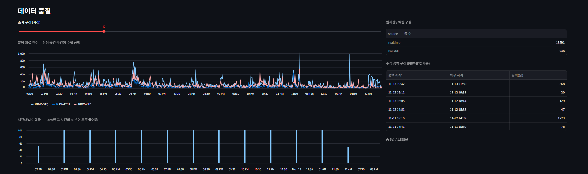
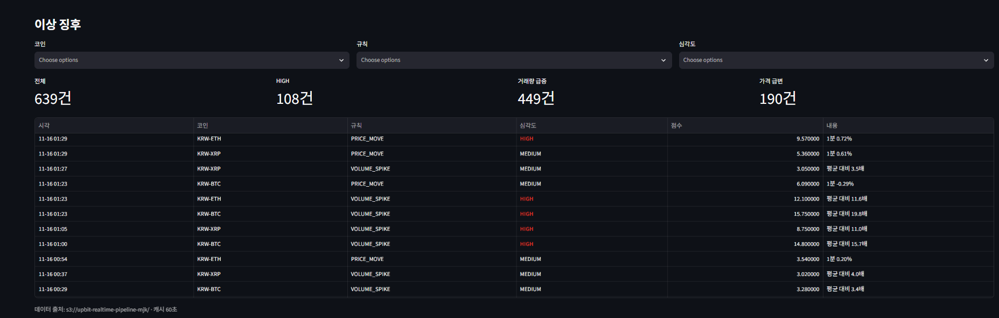

## 운영 기록

3일간 무중단으로 운영하며 데이터 정합성을 측정했다.

| 항목 | 값 |
|---|---|
| 운영 기간 | 2026-11-13 01:50 ~ 2026-11-16 02:29 |
| 연속 가동 | 3일 0시간 39분 |
| 수집기 재연결 | 0회 |
| 집계 분 수 | 6,391분 |
| 수집 공백 | **0분** |
| 건수 불일치 | **0건** |
| 미처리 | 1분 (종료 시점) |
| 수집 체결 | 1,690,095건 |
| 중복 제거 | 1,414건 (0.08%) |

### 검증 방법

`diagnose.py`가 Kafka 원본과 S3 봉을 분 단위로 대조한다. Kafka에서 `trades.raw`와
`trades.backfill`을 읽어 `sequential_id` 기준 distinct 건수를 세고, S3의
`candles`/`candles_backfill`에 기록된 건수와 비교한다.

| 지표 | 의미 |
|---|---|
| `no_source` | Kafka에 원본이 없는 분 (수집 공백) |
| `not_processed` | 원본은 있으나 봉이 없는 분 (처리 실패) |
| `count_mismatch` | 봉과 원본의 건수가 다른 분 |

운영 전후 `no_source`가 1,787에서 변하지 않았다. 3일간 수집 공백이 한 분도
없었다는 뜻이다. `count_mismatch`는 0으로, 생성된 모든 봉이 Kafka 원본과
건수가 일치했다.

`not_processed` 1건은 종료 시점의 마지막 1분이다. 워터마크는 유입 데이터의
이벤트 시각으로 전진하므로 입력이 멈추면 마지막 윈도우가 확정되지 않는다.
설계상 예상된 동작이다.

### 처리 규모와 중복

| 코인 | 체결 건수 |
|---|---|
| KRW-BTC | 829,774 |
| KRW-ETH | 327,426 |
| KRW-XRP | 532,895 |
| **합계** | **1,690,095** |

71.9시간 동안 169만 건, 초당 약 6.5건을 처리했다.

Kafka에 들어온 메시지는 1,691,509건이고 `(code, sequential_id)` 기준 고유
체결은 1,690,095건이다. 차이 1,414건이 중복이다. 이 기간 수집기는 재연결이
0회였고 Producer에 `enable.idempotence`가 켜져 있었으므로 재구독이나 재전송으로
인한 중복은 아니며, 거래소가 같은 체결을 두 번 보낸 것으로 보인다.
`dropDuplicatesWithinWatermark`가 이를 걸러냈고, 걸러지지 않았다면 해당 분의
거래량과 체결 수가 틀어졌을 것이다. `count_mismatch`가 0인 것이 이를 뒷받침한다.

### 이상 감지 결과

| 구분 | 건수 |
|---|---|
| 전체 | 639건 |
| HIGH | 108건 |
| 거래량 급증 | 449건 |
| 가격 급변 | 190건 |

코인마다 변동성이 달라 고정 퍼센트 대신 직전 20분의 표준편차를 기준으로
판정한다. 조용한 구간에서 표준편차가 작아지면 사소한 변화도 z-score가 커지므로,
최소 배수와 최소 변동률을 AND 조건으로 함께 건다. 같은 코인·같은 규칙은
10분 구간당 1건만 남겨 알림 수를 통제한다.

### 관찰: 3일 운영 후 봉 저장 지연

운영 3일차에 1분봉 저장이 7~8분까지 밀렸다. 메타데이터 compaction 시간은
2.0~2.8초로 3일간 일정했으므로 compaction 문제는 아니다.

한 Spark 드라이버에서 원본 체결 저장과 봉 집계 두 스트림이 1코어를 나눠 쓰는
구조이고, 3일간 S3에 누적된 파일(원본 체결 약 13,000개, 봉 약 4,300개)의
목록 조회와 커밋 비용이 늘어난 것이 원인으로 보인다. 수집기를 멈추자 밀려 있던
봉이 모두 채워졌고 Kafka 원본과 건수가 일치했다.

데이터 유실은 없었다. 지연과 유실은 다른 문제이며, 지표가 이를 구분해준다.

개선 방향: 두 스트림을 별도 작업으로 분리하거나 실행기 코어를 늘린다.
파일 수를 줄이려면 봉을 시간 단위로 묶거나 Iceberg·Delta Lake의 compaction을
적용한다.

### 대시보드

3일 연속 운영 후 수집기를 정상 종료한 직후의 상태. "연속 가동 3일 0시간 39분"이
무중단 기간이며, 중단 표시는 의도적 종료에 따른 것이다.

선이 끊긴 구간이 수집 공백이다. 11-13 01:50 이후로는 공백이 없다.

